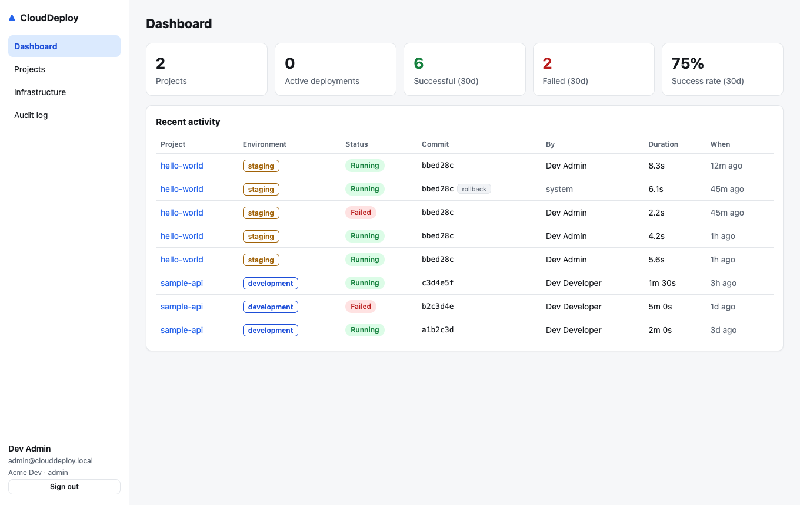
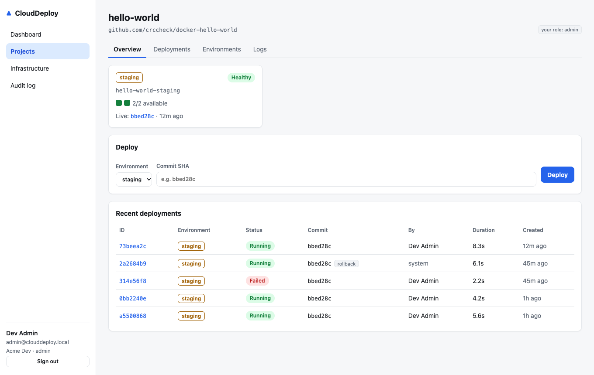
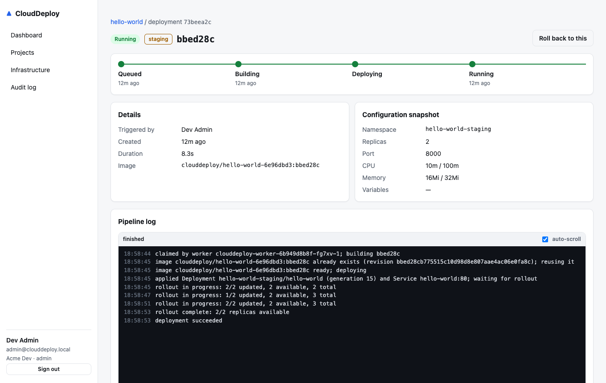
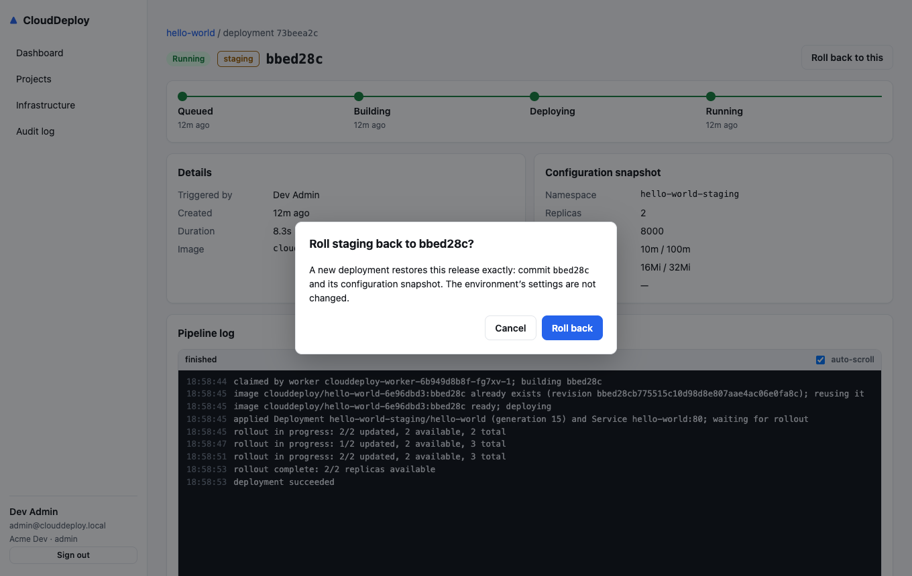
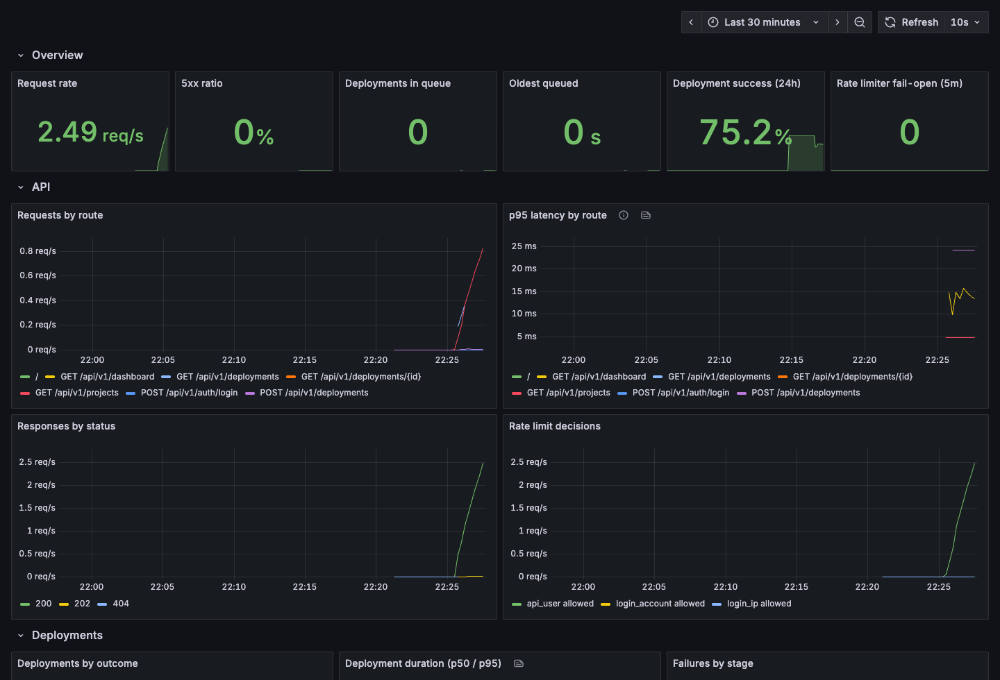
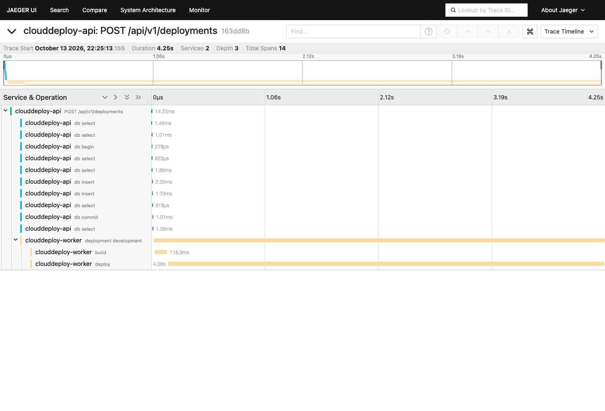

# CloudDeploy

[](https://github.com/vipul2902/Go-Project/actions/workflows/cd.yml)

A cloud-native deployment platform: register an application, define its environments, build it, deploy it to Kubernetes, and track status, health, logs and history — with Azure infrastructure provisioned by Terraform.

> **Status:** Phase 22 (performance) complete. k6 load tests with profiling found the dashboard collapsing at 300k deployments (p95 13.1 s); a status rollup and per-project top-N queries brought it to 8.6 ms, guarded by a nightly performance check. The roadmap is built phase-by-phase; see [Roadmap](#roadmap).

## Screenshots

| Dashboard | Project overview (live health, deploy) |
|---|---|
|  |  |
| **Deployment (timeline, live pipeline log)** | **Rollback confirmation** |
|  |  |

| **Grafana (metrics)** | **Jaeger (one trace: API → queue → worker)** |
|  |  |

More screenshots are in [docs/screenshots](docs/screenshots). The dashboard design is described in [docs/frontend.md](docs/frontend.md).

## Architecture (target)

```
Web UI (React/TS) ──► Go API (REST, /api/v1) ──► PostgreSQL
                          │                  └─► Redis (queue, cache, rate limit)
                          ▼
                   Deployment worker ──► Kubernetes (Deployments, Services, Ingress)
```

It is a **modular monolith**: one deployable Go binary with clear internal package boundaries. See [ADR-004](docs/adr/ADR-004-modular-monolith.md) for why it isn't split into microservices.

## Tech stack

| Area | Choice |
|---|---|
| API | Go 1.27.2, standard library `net/http` routing, `log/slog` JSON logging |
| Dashboard | React 19, TypeScript, Vite, TanStack Query, served by nginx |
| Data | PostgreSQL, Redis *(Phase 2 / 7)* |
| Runtime | Docker (distroless, non-root), Kubernetes + Helm *(Phase 10–11)* |
| Cloud | Terraform 1.16 (azurerm 4.x): AKS, ACR, PostgreSQL Flexible Server, Managed Redis, Key Vault (see [docs/azure.md](docs/azure.md)) |
| CI/CD | GitHub Actions: CI ([docs/ci.md](docs/ci.md)); signed multi-arch images and Helm chart on GHCR, end-to-end deploy test, releases ([docs/cd.md](docs/cd.md)) |

## Quick start

Prerequisites: Go 1.27.2+, Docker (Colima works), GNU Make.

```bash
cp .env.example .env      # then replace every change-me value (openssl rand -hex 24)
make db-up                # Postgres on 127.0.0.1:15432, Redis on 127.0.0.1:16379
make migrate seed         # schema + dev data
make dev                  # run the API natively on :8080
make k8s-up               # local Kubernetes (Colima k3s); skip it to use WORKER_DEPLOYER=dryrun
make worker               # in another terminal: the worker (Docker builds, Kubernetes deploys)
curl localhost:8080/readyz
```

| Command | Purpose |
|---|---|
| `make test-all` | Lint, unit, integration, frontend and Helm checks (add `make test-k8s` for cluster tests) |
| `make fuzz` / `make bench` / `make cover` / `make test-stress` | Fuzzing, benchmarks, combined coverage, 3× race-detector stress run (see [docs/testing.md](docs/testing.md)) |
| `make test` | Unit tests with the race detector |
| `make vulncheck` | govulncheck: reachable vulnerabilities in Go code and dependencies |
| `make test-integration` | Integration tests against real Postgres (`clouddeploy_test` database) |
| `make db-up` / `make migrate` / `make seed` / `make psql` | Database workflow (see [docs/database.md](docs/database.md)) |
| `make lint` | gofmt check, `go vet` and golangci-lint (same config as CI) |
| `make build` | Static binaries in `bin/` (`api`, `worker`) |
| `make docker-build` | Container image `clouddeploy-api` |
| `make docker-up` / `make docker-down` | Full stack in containers: Postgres, then migrate job, then API |
| `make k8s-up` / `make k8s-down` / `make test-k8s` | Local Kubernetes (Colima k3s) and the deployer tests against it |
| `make helm-lint` | Lint the Helm chart with every values file and check its safety guards |
| `make k8s-deploy` / `make k8s-forward` / `make k8s-uninstall` | Run CloudDeploy itself in the cluster with Helm (dev values). `k8s-forward` opens the dashboard on http://localhost:8080. |
| `make perf` | k6 load test of the API and deployment queue with profiling and query stats (`DEPLOYMENTS=300000` for a large organization; see [docs/performance.md](docs/performance.md)) |
| `make e2e` | End-to-end: install the chart beside dev and drive a real deployment through the API (same script as CD) |
| `make obs-up` / `make obs-down` | Opt-in Prometheus, Grafana and Jaeger (see [docs/observability.md](docs/observability.md)) |
| `make terraform-check` / `make terraform-plan ENV=dev` | Offline fmt, validate and mocked tests; a real plan (needs `az login`). No apply target, on purpose (see [docs/terraform.md](docs/terraform.md)). |
| `make azure-images` / `azure-deploy` / `azure-forward` / `azure-stop` | Build on ACR Tasks, deploy to AKS, open the dashboard, pause billing (see [docs/azure.md](docs/azure.md)) |
| `make web-dev` / `make web-check` | Dashboard dev server; type-check, lint, test and build the dashboard |

## Configuration

All configuration comes from environment variables (see [.env.example](.env.example)). The API validates every value at startup and exits with a list of all errors if any are invalid.

| Variable | Default | Notes |
|---|---|---|
| `APP_ENV` | `development` | `development` \| `staging` \| `production` |
| `PORT` | `8080` | |
| `LOG_LEVEL` | `info` | `debug` \| `info` \| `warn` \| `error` |
| `HTTP_READ_TIMEOUT` / `HTTP_WRITE_TIMEOUT` / `HTTP_IDLE_TIMEOUT` | `10s` / `15s` / `60s` | Go duration syntax |
| `SHUTDOWN_TIMEOUT` | `20s` | Maximum time allowed to drain in-flight requests on SIGTERM |
| `DATABASE_URL` | *(required)* | PostgreSQL connection string |
| `DB_MAX_CONNS` / `DB_MIN_CONNS` | `10` / `1` | Pool bounds. Keep `replicas × max` below the server's `max_connections`. |
| `DB_MAX_CONN_LIFETIME` / `DB_MAX_CONN_IDLE_TIME` | `30m` / `5m` | Connection recycling |
| `METRICS_PORT` | `9090` | Internal Prometheus endpoint (`0` disables it); never exposed publicly |
| `PPROF_ENABLED` | `false` | Also serve `/debug/pprof` on the metrics port, for load tests. Refused in production. |
| `OTEL_EXPORTER_OTLP_ENDPOINT` | *(empty)* | Enables tracing, for example `http://localhost:4318` (Jaeger). Empty means no tracing and no cost. |
| `KUBE_CONTEXT` | *(empty)* | API: the cluster for monitoring when running outside one (empty means monitoring returns 503). Worker: required outside a cluster. |
| `TRUSTED_PROXY_CIDRS` | *(empty)* | Proxies allowed to set `X-Forwarded-For`, read from the right (see [security.md](docs/security.md)) |
| `REDIS_URL` | *(required)* | Used for rate limiting. Startup fails if it's unreachable; at runtime an outage fails open (see ADR-003). |
| `JWT_SECRET` | *(required)* | At least 32 bytes. Generate with `openssl rand -base64 48`. |
| `ACCESS_TOKEN_TTL` / `REFRESH_TOKEN_TTL` | `15m` / `720h` | Token lifetimes |

Worker settings (used by `cmd/worker`):

| Variable | Default | Notes |
|---|---|---|
| `WORKER_BUILDER` | *(required)* | `docker` builds images with the local git and docker CLIs; `acr` builds on ACR Tasks (needs `ACR_REGISTRY_ID`); `dryrun` simulates the build. Required on purpose, so nobody mistakes simulated builds for real ones. |
| `WORKER_DEPLOYER` | *(required)* | `kubernetes` applies the app and waits for the rollout; `dryrun` simulates it |
| `KUBE_CONTEXT` | *(required outside a cluster)* | The kubeconfig context to deploy to, for example `colima`. It must be explicit so the worker never deploys to the wrong cluster. |
| `BUILD_WORKDIR` | OS temp dir | Where temporary checkouts are created; each build's directory is deleted afterwards |
| `WORKER_CONCURRENCY` | `2` | Maximum number of deployments processed in parallel (1–32) |
| `WORKER_LEASE_TTL` | `30s` | How long a claim survives without heartbeats before the reaper fails it |
| `WORKER_POLL_INTERVAL` | `5s` | Fallback polling; `NOTIFY` normally wakes the worker immediately |
| `WORKER_PORT` | `8081` | `/healthz` and `/readyz` for Kubernetes probes |

## Endpoints (so far)

| Endpoint | Purpose |
|---|---|
| `GET /healthz` | **Liveness** check. The process is up. It never checks dependencies, so a database outage won't cause restart loops. |
| `GET /readyz` | **Readiness** check. Returns `503` if PostgreSQL is unreachable, so traffic is routed away from this instance. If Redis is down it returns `degraded` with status 200, because the API still works with rate limiting off. |
| `/api/v1/auth/*` | Register, login, refresh, logout, me |
| `/api/v1/organizations/*` | Organizations and member management (RBAC) |
| `/api/v1/projects/*` | Project CRUD with cursor pagination and ETag concurrency control |
| `/api/v1/projects/{id}/environments/*` | Environments (replicas, resources, namespace) and variables. Secrets are stored as references only. |
| `/api/v1/deployments/*` | Create (idempotent and asynchronous), list, get, cancel and **roll back** deployments, and pipeline logs (`?follow=true` streams them) |
| `/api/v1/organizations/{id}/audit` | Audit trail (admin only) |
| `/api/v1/projects/{id}/environments/{env}/health` | Live health, pod status and drift, read from Kubernetes |
| `/api/v1/projects/{id}/environments/{env}/logs` | Application logs, with `?follow=true` for live streaming (SSE) |

The full reference is in [docs/api.md](docs/api.md).

Example:

```bash
curl -s -XPOST localhost:8080/api/v1/auth/login -H 'Content-Type: application/json' \
  -d '{"email":"developer@clouddeploy.local","password":"<SEED_PASSWORD from .env>"}'
```

All errors use one envelope:

```json
{ "error": { "code": "NOT_FOUND", "message": "resource not found", "request_id": "..." } }
```

Every response carries an `X-Request-ID` header. If the client sends a well-formed ID, the API reuses it. That way a single ID can be traced across services and log lines.

## Roadmap

0 audit ✅ · 1 scaffolding ✅ · 2 database ✅ · 3 auth ✅ · 4 orgs/projects ✅ · 5 environments ✅ · 6 deployment domain ✅ · 7 Redis ✅ · 8 async worker ✅ · 9 image builds ✅ · 10 local k8s ✅ · 11 Helm ✅ · 12 monitoring/logs ✅ · 13 rollback ✅ · 14 dashboard ✅ · 15 test hardening ✅ · 16 observability ✅ · 17 Terraform ✅ · 18 Azure ✅ · 19 CI ✅ · 20 CD ✅ · 21 security ✅ · 22 performance ✅ · 23 polish

## Documentation

- [API reference](docs/api.md)
- [Testing strategy: fuzzing, model-based tests, benchmarks](docs/testing.md)
- [Performance: load tests, the dashboard fix, sizing](docs/performance.md)
- [Continuous integration: workflows, pinned actions, scanners](docs/ci.md)
- [Continuous delivery: signed images, end-to-end test, releases](docs/cd.md)
- [Observability: metrics, traces, logs, alerts](docs/observability.md)
- [Terraform: Azure infrastructure, secrets kept out of state](docs/terraform.md)
- [Running on Azure (AKS): ACR Tasks builds, Key Vault, deploy steps](docs/azure.md)
- [Dashboard](docs/frontend.md)
- [Architecture decisions](docs/adr/)
- [Local development](docs/local-development.md)
- [Deployment domain: state machine, idempotency, audit](docs/deployment.md)
- [Kubernetes: tenant deployments, and CloudDeploy on Helm](docs/kubernetes.md)
- [Database design, ERD and indexes](docs/database.md)
- [Security: authentication, tokens, RBAC and database privileges](docs/security.md)
- [Threat model (STRIDE)](docs/threat-model.md) and [security policy](SECURITY.md)
