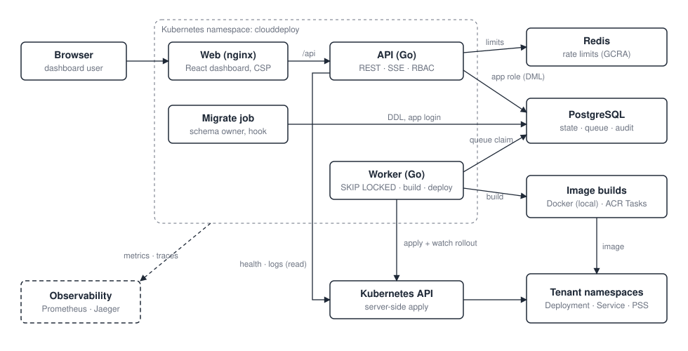
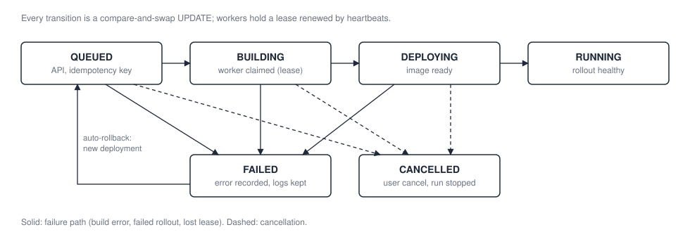
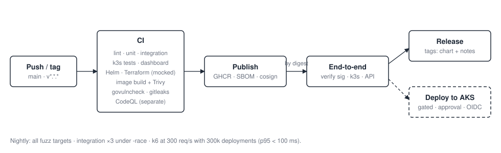

# CloudDeploy

[](https://github.com/vipul2902/Go-Project/actions/workflows/cd.yml)
[](https://github.com/vipul2902/Go-Project/actions/workflows/codeql.yml)
[](https://github.com/vipul2902/Go-Project/releases)

A deployment platform for Kubernetes. Teams register an application, define its environments, and deploy a git commit. CloudDeploy builds the image, rolls it out, watches the rollout, rolls back automatically if it fails, and shows live health, drift and logs on a dashboard.

It's built like production software: a Go API and worker with a PostgreSQL job queue, a React dashboard, a hardened Helm chart, Terraform for Azure, and a CI/CD pipeline that signs releases and proves them with an end-to-end deployment before publishing.



## Highlights

| | |
|---|---|
| **Reliable deployments** | Each deployment is a state machine advanced only by compare-and-swap updates. Workers claim jobs from PostgreSQL with `FOR UPDATE SKIP LOCKED`, hold renewable leases, and are reaped if they die. Creates are idempotent, every change is audited in the same transaction, and auto-rollback restores the last good release. |
| **Measured performance** | k6 load tests at 300 req/s against an organization with 300,000 deployments found the dashboard collapsing (p95 13.1 s). A trigger-maintained rollup and per-project top-N queries brought it to p95 8.6 ms, and a nightly job keeps it there ([performance](docs/performance.md)). |
| **Security in depth** | Argon2id and rotating refresh tokens with reuse detection. RBAC, with production changes reserved for admins. A least-privilege database login with an append-only audit log. Restricted pods, NetworkPolicies, and tenant isolation. A STRIDE [threat model](docs/threat-model.md). |
| **Supply chain** | Actions pinned to commit SHAs. Multi-arch images with SBOM and provenance, signed with cosign (keyless). CD verifies signatures and deploys by digest. govulncheck, Trivy, gitleaks and CodeQL run on every change. |
| **Tested at every layer** | Unit, integration (real PostgreSQL and Redis), fuzzing including differential fuzzing against Kubernetes validators, model-based state machine tests, a route authorization sweep, Kubernetes tests on k3s, mutation checks, and an end-to-end deployment of every published release. |
| **Observable** | Prometheus metrics with bounded labels, OpenTelemetry traces that follow a deployment from the API through the queue into the worker, trace-correlated logs, a Grafana dashboard, and alert rules. |
| **Infrastructure as code** | Terraform for AKS, ACR, PostgreSQL, Managed Redis and Key Vault with private networking. Secrets never enter Terraform state (ephemeral values and write-only arguments). Offline tests run against a mocked provider. |

## Screenshots

| Dashboard | Project overview (live health, deploy) |
|---|---|
|  |  |
| **Deployment (timeline, live pipeline log)** | **Rollback confirmation** |
|  |  |
| **Grafana (metrics)** | **Jaeger (one trace: API → queue → worker)** |
|  |  |

## How a deployment works



1. **Create.** `POST /api/v1/deployments` validates access and snapshots the environment's configuration. It enqueues a `QUEUED` row and a `NOTIFY` in one transaction. The response is `202`.
2. **Claim.** A worker wakes on `NOTIFY`, claims the row with `SKIP LOCKED`, and keeps a lease alive with heartbeats.
3. **Build.** The image is built from the exact commit: Docker locally, or ACR Tasks on Azure, where tenant code never runs in the cluster.
4. **Deploy.** The worker server-side applies the Namespace, Deployment and Service. It watches the rollout and fails fast with diagnostics on crash loops or image pull errors.
5. **Recover.** On failure the deployment ends `FAILED`. If auto-rollback is on, a new deployment restores the last good snapshot. Live health and drift come from the cluster itself.

More detail: [deployment domain](docs/deployment.md) and [Kubernetes](docs/kubernetes.md).

## Try it

### Install a release (any Kubernetes cluster)

The chart expects a PostgreSQL and a Redis, plus a Secret holding `DATABASE_URL`, `REDIS_URL` and `JWT_SECRET`:

```bash
kubectl create namespace clouddeploy
# secrets.env: DATABASE_URL=…, REDIS_URL=…, JWT_SECRET=… (keep it out of git and shell history)
kubectl -n clouddeploy create secret generic clouddeploy-secrets --from-env-file=secrets.env
helm install clouddeploy oci://ghcr.io/vipul2902/charts/clouddeploy --version 1.0.0 -n clouddeploy
```

Migrations run as a pre-install hook. For a least-privilege database login, see [database privileges](docs/security.md#database-privileges). The images and chart are signed; see [verifying a release](docs/cd.md#signing-cosign-keyless).

### Run it locally

Prerequisites: Go 1.27.2+, Docker (Colima works), GNU Make.

```bash
cp .env.example .env      # replace every change-me value (openssl rand -hex 24)
make db-up                # PostgreSQL on 127.0.0.1:15432, Redis on 127.0.0.1:16379
make migrate seed         # schema and development data
make dev                  # API on :8080
make web-dev              # dashboard on :5173 (in another terminal)
```

To deploy for real, run `make k8s-up` (local k3s) and then `make worker`. Without a cluster, run the worker with `WORKER_DEPLOYER=dryrun`. To run the whole platform inside the cluster, use `make k8s-deploy`.

The [demo walkthrough](docs/demo.md) goes from an empty machine to a deployed app, a failed rollout and an automatic rollback in about ten minutes.

## Delivery pipeline



Every push to `main` runs CI. It then publishes signed images to GHCR, verifies them, and deploys them to a fresh k3s cluster, where the end-to-end test drives a real deployment through the API. Version tags also publish the Helm chart and a GitHub Release. The Azure deploy job exists but is gated behind a repository variable and a manual approval. See [CI](docs/ci.md) and [CD](docs/cd.md).

## Commands

| Command | Purpose |
|---|---|
| `make test-all` | Lint, unit, integration, dashboard, Helm and Terraform checks |
| `make test-k8s` / `make e2e` | Kubernetes tests on the local cluster; end-to-end install and deployment |
| `make perf` | k6 load tests with profiling and query statistics (`DEPLOYMENTS=300000` for a large organization) |
| `make fuzz` / `make bench` / `make cover` / `make test-stress` | Fuzzing, benchmarks, coverage, race-detector stress run |
| `make lint` / `make vulncheck` | gofmt, go vet and golangci-lint; govulncheck |
| `make db-up` / `make migrate` / `make seed` / `make psql` | Database workflow |
| `make k8s-up` / `make k8s-deploy` / `make k8s-forward` | Local k3s; CloudDeploy on it with Helm; open the dashboard |
| `make obs-up` | Prometheus, Grafana and Jaeger |
| `make terraform-check` / `make terraform-plan ENV=dev` | Offline Terraform validation and tests; a real plan (needs `az login`) |
| `make azure-images` / `make azure-deploy` | Build on ACR Tasks and deploy to AKS |

Run `make help` for everything else.

## Tech stack

| Area | Choice |
|---|---|
| Backend | Go 1.27 (standard library `net/http`, `log/slog`), pgx, goose migrations, go-redis, client-go |
| Data | PostgreSQL 17 (state, job queue, audit), Redis 7 (rate limiting) |
| Dashboard | React 19, TypeScript, Vite, TanStack Query, served by unprivileged nginx with a strict CSP |
| Runtime | Distroless non-root images, Kubernetes, Helm |
| Cloud | Terraform (azurerm 4): AKS, ACR, PostgreSQL Flexible Server, Managed Redis, Key Vault |
| Delivery | GitHub Actions, GHCR, cosign, Trivy, CodeQL, k6 |
| Observability | Prometheus, OpenTelemetry, Grafana, Jaeger |

It's a **modular monolith**: one codebase with clear package boundaries, two binaries (API and worker) that scale independently, and one database. [ADR-004](docs/adr/ADR-004-modular-monolith.md) explains why it isn't microservices.

## Documentation

| Topic | |
|---|---|
| Getting started | [Demo walkthrough](docs/demo.md) · [Local development](docs/local-development.md) · [Configuration and endpoints](docs/configuration.md) · [API reference](docs/api.md) |
| Design | [Deployment domain](docs/deployment.md) · [Database](docs/database.md) · [Kubernetes](docs/kubernetes.md) · [Dashboard](docs/frontend.md) · [Architecture decisions](docs/adr/) |
| Operations | [Observability](docs/observability.md) · [Performance](docs/performance.md) · [Terraform](docs/terraform.md) · [Azure](docs/azure.md) |
| Quality | [Testing](docs/testing.md) · [CI](docs/ci.md) · [CD](docs/cd.md) |
| Security | [Security](docs/security.md) · [Threat model](docs/threat-model.md) · [Security policy](SECURITY.md) |
